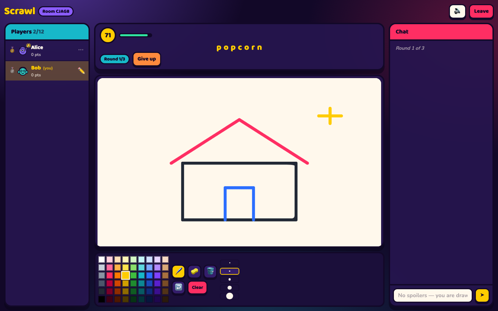

# Scrawl

A free, self-hostable multiplayer drawing-and-guessing party game. One player
draws a secret word, everyone else races to type it, and points go to whoever
reads the picture fastest. No accounts, no ads, no paid tier, no third-party
services — the whole thing is one Node process and a static bundle.



## Why it exists

Drawing games are a good excuse to build something genuinely hard: a real-time
authoritative game server with per-player information hiding, a drawing
protocol that stays in sync across clients, and a scoring system that rewards
skill rather than typing speed. All of that has to work without costing
anything to run.

## Game modes

Three ways to play, picked in the lobby.

| Mode | How it goes |
|---|---|
| 🎨 **Classic** | One word a turn. The drawer picks from three, everyone races to guess. |
| ⚡ **Rapid Fire** | No word picker. The instant somebody gets it, the canvas wipes and the next word is already up — the drawer chains as many as they can before the turn clock dies. Points land per word, for the guesser and the drawer alike. |
| 💀 **Sudden Death** | Classic scoring, but the lowest scorer is knocked out at the end of every round. Last one standing takes it, whatever the scoreboard says. A knocked-out player keeps watching and is shown the word, so they cannot spoil it for anyone still in. |

### Twists

Rule changes that stack on top of any mode, enforced on the server rather than
just hidden in the toolbar:

| Twist | Effect |
|---|---|
| 🪞 **Mirror** | The drawer's strokes come out flipped left to right. The flip is applied to their input, so everybody sees the same canvas — only the hand is backwards. |
| 🚫 **No take-backs** | No eraser, no undo, no clearing. Commit to it. |
| 🎯 **One colour** | A single colour is rolled for the drawer each turn, and nothing else gets through. |

## Features

**Game**
- Three modes and three stacking twists, all host-configurable
- Round-based play: every player draws once per round, 2–10 rounds a game
- The drawer chooses from 1–5 words; a word is auto-picked if they dawdle
- Letters are revealed as hints while the clock runs down (0–5, never more
  than half the word, always two letters left hidden)
- Scores reward guessing early and guessing first; the drawer is paid out of
  what the guessers earned, so an unreadable drawing is worth nothing
- Turn ends early once everybody has it, or on a majority vote to skip
- Per-turn scoreboard, then a podium with the final standings

**Rooms**
- Private rooms with a 5-character code and a one-click invite link; the link
  survives a reload and a shared link opens straight onto a join button
- Public rooms with quick-play matchmaking into the fullest room with space
- 2–20 players, spectators fold into play at the start of the next round
- Reload-proof: refreshing silently reclaims your seat, score intact, because
  the room lives in the address bar and the seat is keyed to browser storage
- Host controls, crown transfer when the host leaves, kick and vote-kick
- Per-player mute, held client-side

**Drawing**
- 54-colour palette, five brush sizes, brush / eraser / flood fill
- Undo a whole stroke, clear the canvas, keyboard shortcuts (`B` `E` `F`,
  `1`–`5`, `Ctrl+Z`)
- Strokes stream live in segments, so guessers watch the picture appear
- The drawer's brush position is shown to everyone

**Chat**
- Correct guesses never appear in the chat
- "'treee' is close!" nudges, sent only to the player who typed it
- Players who have the word are moved to a private channel so they cannot
  hand it to anyone still guessing
- The drawer is blocked from typing the word or anything one edit from it

**Words**
- Six languages: English, Spanish, French, German, Dutch, Hindi
- Hindi is shown in Devanagari and accepts romanised guesses
- Guessing tolerates case, accents, punctuation and German `ae`/`oe`/`ue`
- Custom word lists: mix them in or play on yours alone

**Other**
- Avatars built from SVG primitives — 12 colours × 4 heads × 8 eyes × 8
  mouths × 7 hats, so a face is five small integers on the wire
- Web Audio cues, all from one pentatonic scale, with a mute toggle
- Works on a phone; honours `prefers-reduced-motion`

## Running it

```bash
npm install
npm run dev          # server on :3001, client on :5173
```

Open http://localhost:5173. To play against yourself, open a second window in
a private tab (the seat is keyed to browser storage).

```bash
npm test             # 137 unit and engine tests
npm run build        # shared → server → client
npm start            # one process serving the API and the built client
```

### Deploying

Scrawl holds a WebSocket open to every player for the length of a round, so
the server has to be somewhere that can keep a process alive. That rules out
static hosting and short-lived serverless functions.

**One service (simplest).** `npm run build` then `npm start`. The server
serves `client/dist` itself, so there is nothing else to deploy and no origin
to configure. `render.yaml` is included for a one-click deploy on Render's
free plan; Fly.io and Railway work the same way.

**Split across two hosts.** Put the client on a static host and the server
somewhere that supports WebSockets:

| Half | Host | Build | Environment |
|---|---|---|---|
| Client | Vercel (`vercel.json`), Netlify (`netlify.toml`) or GitHub Pages (`pages.yml`) | `npm run build:client` → `client/dist` | `VITE_SERVER_URL=https://your-server.example.com` |
| Server | Render / Fly / Railway | `npm run build:server` → `npm start` | `CLIENT_ORIGIN=https://your-site.netlify.app` |

`VITE_SERVER_URL` is baked in at build time, so set it before building and
redeploy the client if the server ever moves. `CLIENT_ORIGIN` is what lets the
browser talk across origins; leave it unset and it allows any.

> A static or serverless host alone is not enough — Vercel, Netlify and Pages
> all serve the client perfectly and none of them can run the server. It is
> not a configuration problem: a `Room` keeps its players, its canvas and its
> turn clock in process memory, and the clock is a timer on a live process.
> Serverless invocations get neither. Pair any of them with a host from the
> table above, or use the one-service route and skip the pairing.

### Integration check

With a server running, `node scripts/smoke.mjs` drives two real socket
clients through a whole game — creating a room, joining, drawing, guessing,
reconnecting and reaching the podium — and prints a pass/fail list of 33
checks. It exists for the bugs unit tests structurally cannot see: a socket is
added to a room's channels only after the engine has seated the player, so
anything the engine pushes during `join` goes nowhere. That is why the canvas
and the chat backlog travel with the join reply instead.

## How it fits together

```
shared/   types, the socket contract, scoring, guess matching, hints, words
server/   the authoritative game engine and the Socket.IO wiring
client/   React + Vite, canvas drawing, the UI
```

Three decisions carry most of the design:

**The server is the only authority.** Clients send intent — "I guessed X", "I
drew this stroke" — and the server decides. State is sent per socket, not
broadcast, because what a player may see depends on whether they are drawing
and whether they already have the word. The masked word never leaves the
server in plain form for someone who has not earned it.

**The engine takes its clock and its transport as arguments.** `Room` never
touches `Date.now`, `setTimeout` or a socket directly, so the tests play
entire multi-round games against a fake clock in milliseconds and assert on
exactly what each player was told.

**Drawings are replayed, not streamed as pixels.** Every client runs the same
operations against the same fixed 960×640 buffer, so a flood fill lands
identically everywhere without sending an image. Live strokes arrive as
segments tagged with a group id, which is what lets undo remove a whole drag
rather than the last 60 milliseconds of it.

## Tests

137 tests. The interesting ones are in `server/src/room.test.ts`, which plays
real games: a correct guess never reaches the chat, a player who has the word
cannot leak it, the drawer is blocked from naming it, a disconnect holds the
seat open for 45 seconds without tearing down everyone else's game, and a
departed player is skipped when their turn comes round.

## Supporting it

Scrawl has no ads, no accounts and no paid tier, which leaves the server bill.
If you have had fun with it, UPI to **`ozadhairya73@oksbi`** keeps it running.

## Licence

MIT © Dhairya Oza
